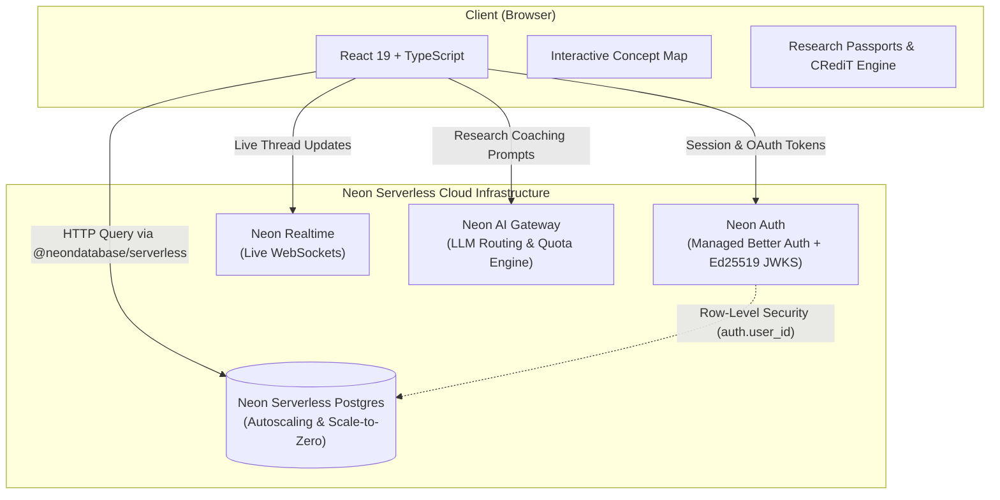

<div align="center">

# Thesia

**The Research Network & Learning Platform for Students**

[](https://react.dev/)
[](https://www.typescriptlang.org/)
[](https://neon.tech/)
[](https://better-auth.com/)
[](LICENSE)

Students find people working on their question, join real research projects in defined CRediT roles, master research methodology in a free Academy, and build a verified public research passport.

[Live Demo](https://thesia-gamma.vercel.app) • [Architecture](#architecture) • [Getting Started](#getting-started) • [Tech Stack](#tech-stack)

</div>

---

## Overview

Thesia bridges the gap between ambitious students and real academic research. By standardizing student research contributions with international academic frameworks (CRediT taxonomy), Thesia provides verifiable proof of work for early-career researchers, undergrads, and high-school students.

### Core Capabilities

- **Project Marketplace:** Browse, filter, and apply for research projects with explicit CRediT contributor roles (Conceptualization, Methodology, Software, Formal Analysis, Writing).
- **Research Passport:** Public, verifiable academic profiles tracking confirmed project contributions, published outputs, and earned certifications.
- **Concept Atlas:** Live interactive concept map connecting multidisciplinary topics and research questions.
- **Free Academy:** 5 curated methodology tracks (23 interactive lessons) covering scoping, fieldwork, data analysis, reporting, and literature sourcing.
- **Ecosystem Directory:** Verified national research labs, 2026 academic conferences, deadlines, and international fellowships.
- **AI Research Mentor:** Context-aware research guide powered by Claude and grounded in academic research ethics.

---

## Architecture

Thesia is engineered for speed, minimal bundle overhead, and zero backend server maintenance using the **Neon Serverless Stack**:



- **Database:** Serverless Postgres decoupled storage and compute with instant branching and scale-to-zero.
- **Driver:** `@neondatabase/serverless` over stateless HTTP `fetch()`—zero connection pooling bottlenecks.
- **Authentication:** Native Managed Better Auth residing directly inside the database (`neon_auth` schema), preserving user state across database branches.
- **Build System:** Zero-bundler overhead—compiled directly with custom `esbuild` pipeline producing full static prerenders for SEO alongside client hydration bundles.

---

## Tech Stack

| Layer | Technology |
|---|---|
| **Frontend Framework** | React 19, TypeScript, React Icons |
| **Typography & Design** | Custom Design System, Literata & Atkinson Hyperlegible Next fonts |
| **Bundling & SEO** | `esbuild` custom pipeline (`scripts/build.mjs`), static prerendering |
| **Database** | Neon Serverless PostgreSQL (pgcrypto, Row-Level Security) |
| **Database Driver** | `@neondatabase/serverless` |
| **Authentication** | Neon Auth (Managed Better Auth) |
| **Realtime** | Neon Realtime WebSocket streams |
| **Hosting** | Vercel (Edge CDN + Static Distribution) |

---

## Getting Started

### Prerequisites
- Node.js 20+
- Neon account ([neon.tech](https://neon.tech))

### 1. Clone & Install
```bash
git clone https://github.com/AhmadAkhtar007/thesia.git
cd thesia
npm install
```

### 2. Configure Environment
Copy the example environment template:
```bash
cp .env.example .env.local
```
Fill in your Neon connection strings and endpoints from your Neon Console.

### 3. Run Schema Migrations
Apply the database schema, security policies, and seed data:
```bash
node scripts/migrate-neon.mjs
```

### 4. Start Development Server
```bash
npm run dev
```
Open [http://localhost:5173](http://localhost:5173) in your browser.

---

## Production Build

```bash
# Compile web distribution with prerendered SEO pages
npm run build

# Run TypeScript type safety checks
npm run typecheck
```

---

## Project Structure

```
thesia/
├── .env.example          # Clean environment configuration template
├── neon.ts               # Neon Infrastructure-as-Code policy
├── scripts/
│   ├── build.mjs         # esbuild build and prerendering pipeline
│   └── migrate-neon.mjs  # Neon database migration runner
├── neon/
│   └── setup.sql         # Core schema, RLS policies, and seed data
├── src/
│   ├── components/       # Layout, concept map, ledger rows, UI primitives
│   ├── data/             # Curated conferences, labs, bootcamps, and lessons
│   ├── lib/              # Database client, Neon adapters, matching engine
│   ├── pages/            # Application routes (Tools, Academy, Passports)
│   └── styles/           # Lab notebook design system tokens
└── docs/                 # Operational and setup runbooks
```

---

## License

Copyright © 2026 Thesia. All rights reserved.
Unauthorized copying, modification, or distribution of this software is strictly prohibited.
